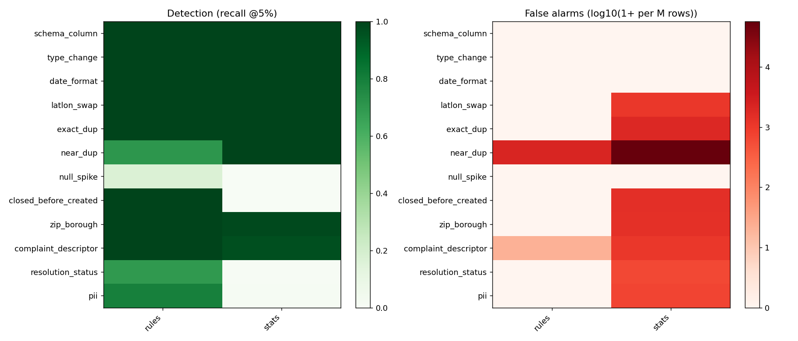

# RESULTS_B: Rules vs LLMs for data quality (generated; edit the [HUMAN] parts)

## 1. Data and what "clean" means
NYC 311 requests created in 2023 (3,224,723 raw rows). Clean = no row-level issue from the profile
(see profile/out/REAL_ISSUES.md): 2,005,000 rows in 401 batches of 5000
(200 reference, 201 held-out). False-alarm rates are measured on held-out
clean batches, so they exclude real issues that the clean definition removed (optimistic).

| issue                                             |   count |   pct | proposed_check_family    |
|:--------------------------------------------------|--------:|------:|:-------------------------|
| leading/trailing/double whitespace                |  688235 | 21.3  | rules (regex)            |
| resolution text contradicts status                |  358148 | 11.1  | stats (TF-IDF+LR) / LLM  |
| near duplicate (same content, same hour, new key) |  238014 |  7.38 | stats (blocking + fuzzy) |
| PII-like: phone number in free text               |  108678 |  3.37 | rules (regex)            |
| null latitude                                     |   48579 |  1.51 | rules (null contract)    |
| null longitude                                    |   48579 |  1.51 | rules (null contract)    |
| null descriptor                                   |   39318 |  1.22 | rules (null contract)    |
| null incident_zip                                 |   38520 |  1.19 | rules (null contract)    |

## 2. Detection, false alarms and cost at 5% injection
Machine: Intel64 Family 6 Model 154 Stepping 3, GenuineIntel, 16 cores, nan GB RAM, single process.
fa = false alarms per million clean rows (batch-level problems: flagged batches per million rows), with 95% bootstrap CI over
10 clean batches. Cost formula: compute $/M = (1e6 / rows_per_sec) / 3600 x $0.05/vCPU-hour;
LLM $/M = (tokens per call x list price) x calls per M rows. LLM model gemini-2.5-flash-lite: $0.1/M input and
$0.4/M output tokens (https://ai.google.dev/gemini-api/docs/pricing, 2026-10-20 (read via third-party mirrors; [HUMAN] re-check on the official page)). LLM rows come from SAMPLES (see eval/out/llm_results.csv
for sample sizes) and are extrapolated; their precision is recomputed at 5% prevalence. Full grid (all rates): eval/out/master_all.csv.

| problem_type          | family   |   recall |   precision | fa (CI)                |   rows_per_sec |   total_usd_per_m |   explain_mean |
|:----------------------|:---------|---------:|------------:|:-----------------------|---------------:|------------------:|---------------:|
| schema_column         | rules    |   1      |       1     | 0 [0-0]                |       2.85e+08 |          4.87e-08 |          0.667 |
| type_change           | rules    |   1      |       1     | 0 [0-0]                |       2.84e+07 |          4.89e-07 |          2     |
| date_format           | rules    |   1      |       1     | 0 [0-0]                |       7.99e+08 |          1.74e-08 |          2     |
| latlon_swap           | rules    |   1      |       1     | 0 [0-0]                |       9.3e+06  |          1.49e-06 |          2     |
| exact_dup             | rules    |   1      |       1     | 0 [0-0]                |       6.06e+05 |          2.29e-05 |          2     |
| near_dup              | rules    |   0.704  |       0.954 | 2,200 [1,940-2,480]    |       1.81e+05 |          7.66e-05 |          2     |
| null_spike            | rules    |   0.167  |       1     | 0 [0-0]                |       2.61e+06 |          5.33e-06 |          2     |
| closed_before_created | rules    |   1      |       1     | 0 [0-0]                |       5.13e+07 |          2.71e-07 |          2     |
| zip_borough           | rules    |   1      |       1     | 0 [0-0]                |       2.42e+06 |          5.74e-06 |          2     |
| complaint_descriptor  | rules    |   1      |       0.999 | 20 [0-60]              |       3.46e+06 |          4.01e-06 |          2     |
| resolution_status     | rules    |   0.693  |       1     | 0 [0-0]                |       8.33e+04 |          0.000167 |          2     |
| pii                   | rules    |   0.791  |       1     | 0 [0-0]                |       3.03e+04 |          0.000458 |          2     |
| schema_column         | stats    |   1      |       1     | 0 [0-0]                |       4.52e+08 |          3.07e-08 |          0.667 |
| type_change           | stats    |   1      |       1     | 0 [0-0]                |       1.86e+05 |          7.48e-05 |          2     |
| date_format           | stats    |   1      |       1     | 0 [0-0]                |       5.7e+08  |          2.44e-08 |          0     |
| latlon_swap           | stats    |   1      |       0.975 | 1,100 [800-1,440]      |       1.44e+05 |          9.66e-05 |          2     |
| exact_dup             | stats    |   1      |       0.967 | 1,940 [840-3,500]      |       2.91e+04 |          0.000477 |          0     |
| near_dup              | stats    |   1      |       0.457 | 57,640 [54,160-61,100] |       1.18e+04 |          0.00117  |          0     |
| null_spike            | stats    |   0      |     nan     | 0 [0-0]                |       2.9e+05  |          4.79e-05 |        nan     |
| closed_before_created | stats    |   0      |       0     | 1,500 [1,200-1,860]    |       1.82e+05 |          7.65e-05 |          0     |
| zip_borough           | stats    |   0.982  |       0.973 | 1,400 [1,060-1,700]    |       4.77e+06 |          2.91e-06 |          0     |
| complaint_descriptor  | stats    |   0.965  |       0.981 | 1,120 [660-1,600]      |       5.11e+05 |          2.72e-05 |          2     |
| resolution_status     | stats    |   0.006  |       0.2   | 640 [340-1,000]        |       3.96e+04 |          0.00035  |          1     |
| pii                   | stats    |   0.0107 |       0.485 | 720 [520-920]          |       6.78e+04 |          0.000205 |          0     |

### Negative results (generated)
- (no problem type where the LLM was both worse and costlier, or LLM results are missing)

## 3. Hybrid pipeline on a mixed stream
Plan per problem type (chosen from section 2): eval/out/hybrid_plan.csv.

| problem_type          |   recall |   precision |    f1 |   recall_no_llm |   precision_no_llm | chosen_family   |
|:----------------------|---------:|------------:|------:|----------------:|-------------------:|:----------------|
| schema_column         |    1     |       1     | 1     |           1     |              1     | rules           |
| type_change           |    1     |       1     | 1     |           1     |              1     | rules           |
| date_format           |    1     |       1     | 1     |           1     |              1     | rules           |
| latlon_swap           |    1     |       1     | 1     |           1     |              1     | rules           |
| exact_dup             |    1     |       1     | 1     |           1     |              1     | rules           |
| near_dup              |    0.699 |       0.967 | 0.812 |           0.699 |              0.967 | rules           |
| null_spike            |    0.333 |       1     | 0.5   |           0.333 |              1     | rules           |
| closed_before_created |    1     |       1     | 1     |           1     |              1     | rules           |
| zip_borough           |    1     |       1     | 1     |           1     |              1     | rules           |
| complaint_descriptor  |    1     |       1     | 1     |           1     |              1     | rules           |
| resolution_status     |    0.688 |       1     | 0.815 |           0.688 |              1     | rules           |
| pii                   |    0.814 |       1     | 0.897 |           0.814 |              1     | rules           |

Ablation (what the LLM adds, per dollar):

| metric                         | 0                     | 1                  |
|:-------------------------------|:----------------------|:-------------------|
| config                         | hybrid_without_llm    | hybrid_with_llm    |
| macro_recall                   | 0.8779059829059829    | 0.8779059829059829 |
| macro_precision                | 0.9972517730496454    | 0.9972517730496454 |
| macro_f1                       | 0.9187056287819594    | 0.9187056287819594 |
| clean_fa_rows_per_m            | 2583.333333333333     | 2583.333333333333  |
| clean_batches_with_batch_alert | 0                     | 0                  |
| llm_calls                      | 0                     | 0                  |
| llm_calls_per_batch            | 0.0                   | 0.0                |
| llm_in_tokens                  | 0                     | 0                  |
| llm_out_tokens                 | 0                     | 0                  |
| llm_unavailable_calls          | 0                     | 64                 |
| compute_usd_per_m              | 0.0008118749427501    | 0.0007529593924611 |
| llm_usd_per_m                  | 0.0                   | 0.0                |
| total_usd_per_m                | 0.0008118749427501    | 0.0007529593924611 |
| compute_seconds                | 14.18118200000572     | 13.152092299997094 |
| llm_seconds                    | 6.579999717359897e-05 | 0.1786432000026252 |
| wall_seconds                   | 14.181696600000578    | 13.33139879999908  |
| rows                           | 242600                | 242600             |
| batches                        | 48                    | 48                 |
| rows_per_sec_cheap_part        | 17107.177666847667    | 18445.73429583167  |
| f1_gain_per_extra_usd_per_m    | nan                   | nan                |

Sample of 10 alerts:

| batch_has_problem     | alert_type            | level   |   rows_flagged | explanation                                                                                                                                |
|:----------------------|:----------------------|:--------|---------------:|:-------------------------------------------------------------------------------------------------------------------------------------------|
| null_spike            | null_spike            | batch   |            158 | column incident_zip is 3.2% null, above the reference limit 2.0%                                                                           |
| resolution_status     | resolution_status     | row     |             28 | 28 rows: resolution_description says 'Your request is still pending and has not been reviewed.' but status is 'Closed'                     |
| type_change           | type_change           | batch   |              0 | column longitude has dtype kind 'O' but the contract says 'f'                                                                              |
| zip_borough           | complaint_descriptor  | row     |              1 | 1 rows: descriptor 'Contrary To LL 58/87(Handicapped Access)' was never seen with complaint_type 'Special Projects Inspection Team (SPIT)' |
| schema_column         | schema_column         | batch   |              0 | column contract broken: missing columns ['closed_date'], unexpected columns ['ClosedDate']                                                 |
| schema_column         | schema_column         | batch   |              0 | column contract broken: missing columns ['complaint_type'], unexpected columns []                                                          |
| null_spike            | null_spike            | batch   |            158 | column descriptor is 3.2% null, above the reference limit 2.0%                                                                             |
| null_spike            | complaint_descriptor  | row     |             36 | 36 rows: descriptor None was never seen with complaint_type 'Sewer'                                                                        |
| exact_dup             | exact_dup             | row     |             50 | 50 rows: row repeats an earlier row exactly (unique_key 56519165)                                                                          |
| closed_before_created | closed_before_created | row     |            250 | 250 rows: closed_date 2023-02-11 10:05:50 is before created_date 2023-02-13 10:05:50                                                       |

## 4. Scale: 50M rows/day x 120 customers
| metric                                        |      value | formula_or_assumption                                      |
|:----------------------------------------------|-----------:|:-----------------------------------------------------------|
| rows per day (assumption, all customers)      |   5e+07    | given                                                      |
| customers                                     | 120        | given; rows per customer per day = rows/customers = 416667 |
| average rows/sec needed                       | 579        | rows_per_day / 86400                                       |
| peak rows/sec needed                          |   2.89e+03 | average x 5 (assumption)                                   |
| measured cheap-path throughput, rows/sec/core |   1.71e+04 | hybrid stream, LLM time excluded                           |
| cores needed at peak                          |   1        | ceil(peak / (throughput x 0.6 utilisation))                |
| batches per day                               |   1e+04    | rows_per_day / 5000                                        |
| LLM calls per batch (measured)                |   0        | hybrid_with_llm run                                        |
| LLM calls per day                             |   0        | batches x calls per batch                                  |
| LLM $ per call (measured tokens x list price) |   0        | 0 in + 0 out tokens                                        |
| LLM $ per day                                 |   0        | calls per day x $ per call                                 |
| LLM $ per day if sample rate doubles          |   0        | sensitivity: 2x calls (assumption)                         |
| naive per-row LLM $ per day                   | nan        | one call per row, tokens from per_row mode                 |
| latency per batch, cheap path (s)             |   0.274    | measured                                                   |
| latency per batch, LLM wait (s)               |   0.00372  | measured, includes free-tier pacing                        |
| storage bytes per row (parquet)               |  47.4      | clean parquet size / rows                                  |
| storage per day (GB)                          |   2.21     | bytes_per_row x rows_per_day                               |
| storage for 30 days (TB)                      |   0.0647   | retention assumption                                       |

[HUMAN] Write the design discussion here (max 2 pages total): engine change (DuckDB/Spark), per-customer baselines and schema
mapping, LLM for schema-mapping/onboarding and alert triage instead of per-row, caching, baseline drift, alert-fatigue controls,
per-customer thresholds, PII via cheaper NER. Sensitivity line is in the table (LLM sample rate x2).
